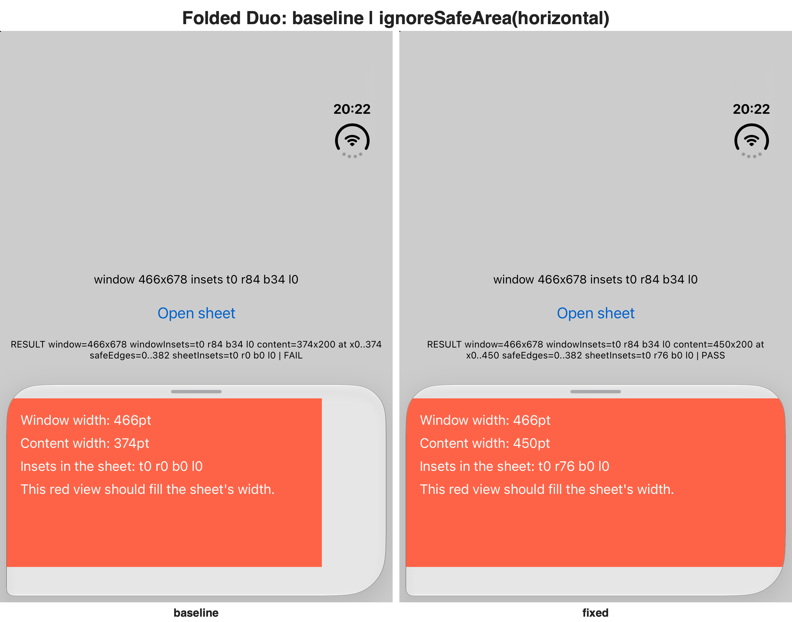
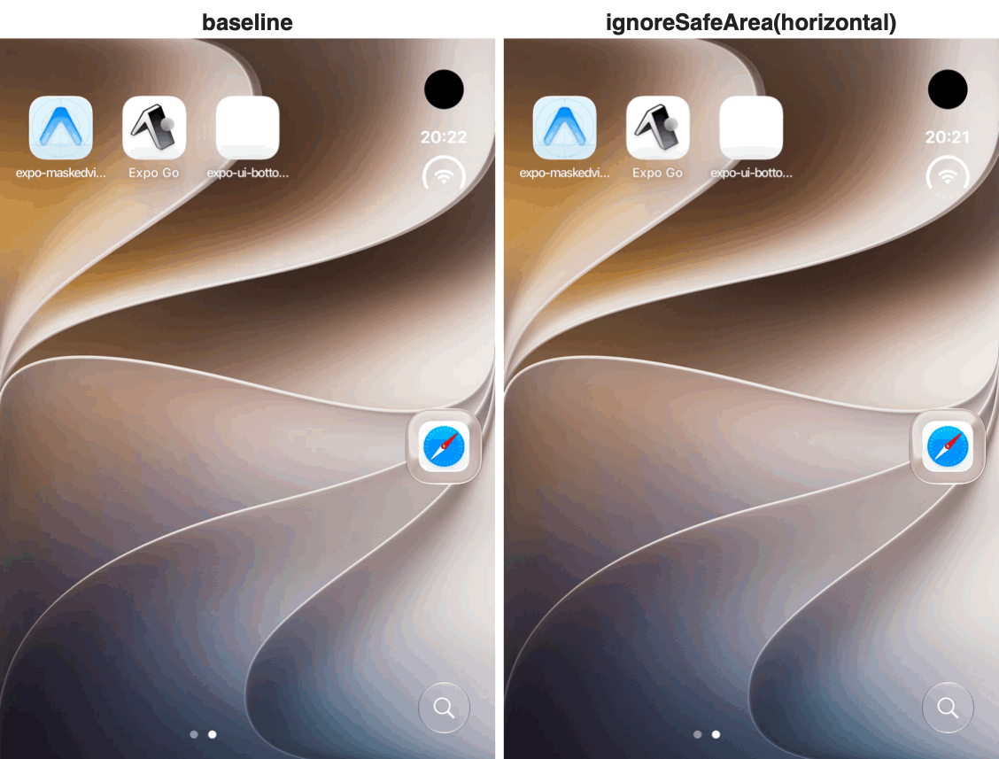

# community BottomSheet content and a side safe-area inset

Reproduction and measurements for [expo/expo#53369](https://github.com/expo/expo/issues/53369):
on iOS, the `@expo/ui/community/bottom-sheet` content stops short of the sheet's edge when the
window has a horizontal safe-area inset, and the component has no way to add modifiers.

Expo SDK 58 (`expo` 58.0.21, `@expo/ui` 58.0.28 built from source, `expo-modules-core` 58.0.28),
React Native 0.88.0, `react-native-safe-area-context` 5.10.1, Xcode 27.2, 11/12/26.
Simulators: iPhone Duo (iOS 27.1, folded, 466×678 pt, side rail = 84 pt right inset) and
iPhone 17 (iOS 26.5), portrait and pinned to landscape (874×402 pt, 62 pt insets on both sides).

## What the app does

A button opens a `BottomSheet` whose content is a full-width red view, as in the issue. With
`AUTORUN` (App.js) the sheet opens 1.5 s after launch and the app prints one `RESULT` line with
the window size, the window insets, the content size and the insets a `SafeAreaProvider` inside
the sheet reports. `scripts/measure` reads the end-frame screenshot and reports the sheet's and
the content's horizontal extents in points, so the verdict does not depend on what JS can see.

## Setup

```sh
npm install
npx expo prebuild -p ios --no-install && (cd ios && pod install)
scripts/build.sh <udid>            # xcodebuild + simctl install
CI=1 npx expo start --port 8081 --clear
DISPLAY_ARG=--display=1 scripts/record.sh <duo udid> baseline-duo   # omit DISPLAY_ARG on other devices
scripts/measure media/baseline-duo-end.png 3
```

## Runs

| Run | Sheet | Content | Gap on the inset side | Insets inside the sheet |
| --- | --- | --- | --- | --- |
| Duo folded, baseline (the issue) | 450 pt | 374 pt | 76 pt | r0 b0 |
| Duo folded, `ignoreSafeArea({ edges: 'horizontal' })` | 450 pt | 450 pt | 0 pt | r76 b0 |
| iPhone 17 landscape, baseline | 874 pt | 750 pt | 62 pt each side | l0 r0 |
| iPhone 17 landscape, `ignoreSafeArea({ edges: 'horizontal' })` | 874 pt | 874 pt | 0 pt | l62 r62 |
| iPhone 17 portrait, baseline (control) | 386 pt | 386 pt | none | none |

`RESULT` lines are in `media/<run>-results.txt`, end frames in `media/<run>-end.png`, recordings
in `media/<run>.mp4`. Sheet and content widths come from `scripts/measure` on the end frames.

The folded Duo matches the issue's numbers (window 466 pt, content 374 pt). The sheet is 450 pt
wide (8 pt margins), so the content is 76 pt short of the sheet's trailing edge, the rail's 84 pt
inset minus the margin.




